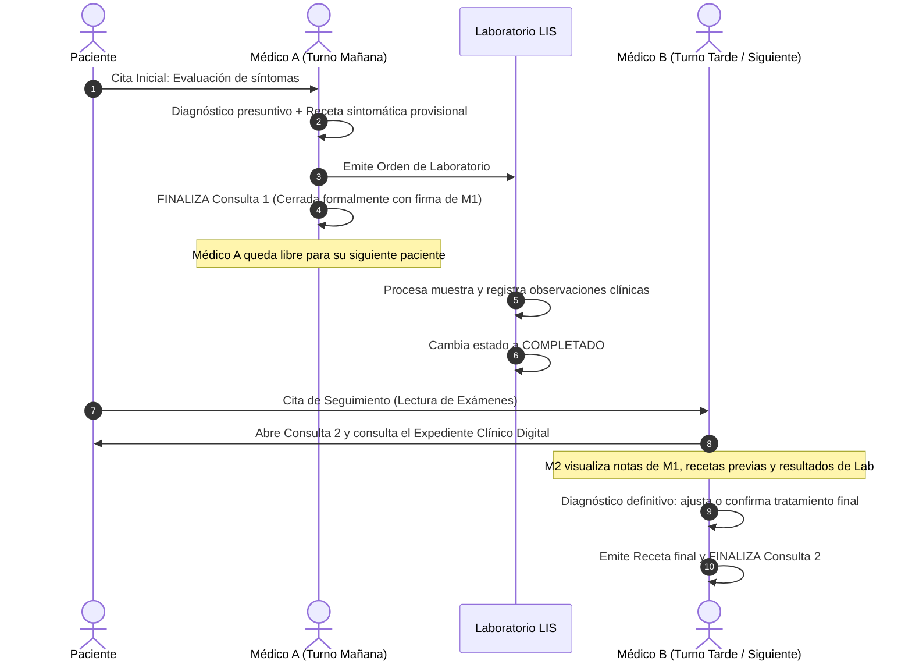
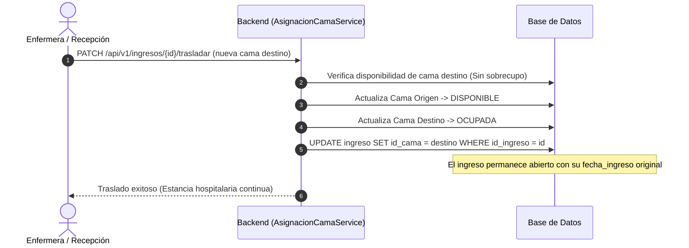

# 🏥 Aclaración de Reglas de Negocio y Flujos Hospitalarios
**Proyecto:** Sistema Integral Hospitalario CMO / Hospital Universitario  
**Cátedra:** Desarrollo de Aplicaciones Móviles Avanzadas — Ciclo II-2026  
**Documento Técnico:** Definición Operativa, Aclaraciones de Arquitectura y Matriz de Refactorización

---

## 📑 Tabla de Contenidos
1. [Contexto Institucional y Directrices de Cátedra](#1-contexto-institucional-y-directrices-de-cátedra)
2. [Arquitectura de Seguridad: Permisos Basados en Cargo](#2-arquitectura-de-seguridad-permisos-basados-en-cargo)
3. [Aclaración de Flujos Operativos y Nuevas Políticas](#3-aclaración-de-flujos-operativos-y-nuevas-políticas)
   * 3.1 [Onboarding de Pacientes: Código por Correo y Fallback Presencial](#31-onboarding-de-pacientes-código-por-correo-y-fallback-presencial)
   * 3.2 [Segregación Funcional: Recepcionista vs. Enfermera](#32-segregación-funcional-recepcionista-vs-enfermera)
   * 3.3 [Agendamiento por Especialidad y Desacoplamiento de Médico en Seguimiento](#33-agendamiento-por-especialidad-y-desacoplamiento-de-médico-en-seguimiento)
   * 3.4 [Privacidad y Mínimo Privilegio en el Expediente Clínico](#34-privacidad-y-mínimo-privilegio-en-el-expediente-clínico)
   * 3.5 [Cartelera Dinámica de Especialidades en Turno](#35-cartelera-dinámica-de-especialidades-en-turno)
   * 3.6 [Laboratorio Clínico (LIS): Monitor de 3 Estados y Observaciones](#36-laboratorio-clínico-lis-monitor-de-3-estados-y-observaciones)
   * 3.7 [Hospitalización (17 Camas) y Corrección de Traslados](#37-hospitalización-17-camas-y-corrección-de-traslados)
   * 3.8 [Atención de Urgencias y Ambulancia](#38-atención-de-urgencias-y-ambulancia)
4. [Diagramas de Secuencia de los Flujos Principales](#4-diagramas-de-secuencia-de-los-flujos-principales)
5. [Plan de Acción y Checklist de Implementación](#5-plan-de-acción-y-checklist-de-implementación)

---

## 1. Contexto Institucional y Directrices de Cátedra

Para que el sistema sea viable tanto ante la **rúbrica de evaluación académica** como en su **lógica de ingeniería de software**, se establecen los siguientes principios rectores:

### 1.1 Distribución Oficial Multiplataforma
* 🍏 **App iOS (Xcode / Swift):** Diseñada para la interacción móvil profesional y de cara al paciente:
  * **Médicos:** Consulta clínica, prescripción de recetas y solicitudes de exámenes.
  * **Pacientes:** Auto-registro, solicitud de citas, historial de recetas y seguimiento de órdenes.
* 🤖 **App Android (Android Studio / Kotlin):** Orientada a las operaciones de ventanilla y punto de atención:
  * **Recepcionistas:** Admisión presencial, asignación de camas, confirmación de citas y despacho de ambulancia.
  * **Enfermeros / Asistentes:** Triage, cuidados a pie de cama y descargo de insumos.
  * **Médicos:** Consulta y rondas en piso.
* 💻 **Web Administrativa (React 19 + TypeScript):** Panel central exclusivo para **Administradores Generales y Jefes de Operaciones**:
  * Diseñado como **centro de mando, observabilidad y detección de cuellos de botella** (tiempo de espera de citas, saturación de camas, retención de ambulancia).
  * **No es una herramienta de mostrador:** No se agendan citas en la Web porque esa tarea pertenece a la ventanilla (Android) o al paciente (iOS).

### 1.2 Entorno de Hospital Escuela / Universitario
* Los médicos son residentes, internos o docentes que rotan periódicamente de acuerdo con la matriz de horarios (`turno_personal`).
* La infraestructura física de internamiento es fija y estricta:
  * **3ª Planta (VIP):** 5 habitaciones individuales (`VIP-301` a `VIP-305`) = 5 camas.
  * **2ª Planta (Semiprivadas):** 6 habitaciones dobles (`HAB-201` a `HAB-206`) = 12 camas.
  * **Capacidad total:** 17 camas fijas sin sobrecupo ni doble asignación.
  * **Sin pabellón de choque independiente:** Las emergencias asistidas por la ambulancia única ingresan directamente a una cama de hospitalización asignada de inmediato en 2ª o 3ª planta.

---

## 2. Arquitectura de Seguridad: Permisos Basados en Cargo

Para preservar la integridad de la base de datos y evitar inconsistencias en las aplicaciones cliente (Android/iOS), **el valor de `users.rol` se mantiene intacto como enum de 4 roles base**. Sin embargo, la autorización de endpoints y pantallas se rige estrictamente por el campo **`users.cargo`**:

```
                       ┌────────────────────────────────────────────────────────┐
                       │                   users.rol (Base)                     │
                       └──────────────────────────┬─────────────────────────────┘
                                                  │
                 ┌────────────────────────────────┴────────────────────────────────┐
                 ▼                                                                 ▼
           ADMINISTRADOR                                                     RECEPCIONISTA
                 │                                                                 │
       ┌─────────┴─────────┐                                             ┌─────────┴─────────┐
       ▼                   ▼                                             ▼                   ▼
Cargo: "Dirección"   Cargo: "Jefe Op."                             Cargo: "Recepcionista" Cargo: "Enfermera"
(Control Total)      (Supervisión / Solo Lectura)                  (Agenda, Citas, Cama) (Piso, Signos, Insumos)
```

### Matriz de Atribuciones por Cargo

| Rol Base (`rol`) | Cargo Asignado (`cargo`) | Dispositivo | Atribuciones Específicas |
| :--- | :--- | :---: | :--- |
| `ADMINISTRADOR` | **Administrador General / Dirección** | Web | Alta y baja de usuarios, configuración del sistema, catálogo de recursos y reportes financieros. |
| `ADMINISTRADOR` | **Jefe de Operaciones** | Web | Programación de turnos del personal, auditoría de cuellos de botella, censo de camas y bitácora de ambulancia. |
| `RECEPCIONISTA` | **Recepcionista de Mostrador** | Android | Admisión de pacientes, agendamiento y confirmación de citas, emisión de códigos de activación presenciales y despacho de ambulancia. |
| `RECEPCIONISTA` | **Enfermera / Asistente de Piso** | Android | Triage, toma de signos vitales, administración y descargo de insumos, monitoreo exclusivo de pacientes ingresados en camas. |
| `RECEPCIONISTA` | **Paramédico de Ambulancia** | Android | Envío de telemetría de ruta, reporte de signos vitales y estado del paciente (`ESTABLE`, `DELICADO`, `CRITICO`) con ETA. |
| `MEDICO` | **Médico (Cualquier especialidad)** | iOS / Android | Consulta médica, diagnóstico, recetas farmacológicas, solicitudes de laboratorio y programación de seguimientos. |
| `MEDICO` | **Médico de Emergencia** | iOS / Android | Atención inmediata de casos críticos derivados de la ambulancia. |
| `PACIENTE` | **Paciente** | iOS | Consulta de recetas activas, expediente personal y solicitud de citas en especialidades disponibles. |

---

## 3. Aclaración de Flujos Operativos y Nuevas Políticas

### 3.1 Onboarding de Pacientes: Código por Correo y Fallback Presencial
* **Flujo Principal:** Al crear el expediente en recepción (`POST /api/v1/pacientes`), si se registra un correo electrónico, el backend despacha un email transaccional con el código de activación (6 dígitos, vigencia 24h).
* **Fallback Presencial:** Si el paciente no dispone de correo o conectividad, la recepcionista conserva un botón en pantalla para generar el código impreso o verbal en mostrador (`POST /api/v1/pacientes/{id}/codigo-activacion`).

### 3.2 Segregación Funcional: Recepcionista vs. Enfermera
* Ambos usuarios poseen `rol = 'RECEPCIONISTA'`, pero el middleware de autorización valida el `cargo`:
  * El cargo **Recepcionista** no tiene acceso a notas clínicas ni a la administración de insumos médicos.
  * El cargo **Enfermera** tiene restringido el agendamiento y confirmación de citas ambulatorias.

### 3.3 Agendamiento por Especialidad y Desacoplamiento de Médico en Seguimiento
* **Citas de Primera Vez:**
  * El **Paciente** solicita cupo para una **Especialidad Médica** (p. ej. Medicina General, Alergología), no para un médico con nombre propio.
  * La **Recepcionista** aprueba solicitudes o agenda pacientes presenciales (*walk-in*) asignando el consultorio y bloque disponible.
* **Citas de Seguimiento y Rotación Médica (Desacoplamiento):**
  * El médico puede emitir citas de control a pacientes que ya ha atendido.
  * **Regla de Rotación:** La cita de seguimiento se programa para la especialidad requerida. **No se amarra de forma restrictiva al médico que la ordenó**.
  * Al llegar el día de la cita de seguimiento, cualquier doctor que esté cubriendo el turno de esa especialidad puede abrir la consulta y acceder a los antecedentes previos.

### 3.4 Privacidad y Mínimo Privilegio en el Expediente Clínico
* **Recepción:** Acceso acotado a la ficha demográfica (nombre, DUI, teléfono, fecha de nacimiento y estado de cita). Bloqueo total a diagnósticos, recetas y notas médicas confidenciales.
* **Enfermería:** Visualización del historial clínico integral, antecedentes y prescripciones **restringida estrictamente a los pacientes que poseen un ingreso activo en camas** bajo su guardia.
* **Médico de Turno:** Autorización para consultar el expediente completo de cualquier paciente que tenga una cita programada en su turno o que ingrese a su servicio.

### 3.5 Cartelera Dinámica de Especialidades en Turno
* Desde la app móvil, el paciente puede consultar en tiempo real qué especialidades y servicios tienen médicos activos durante el día o la semana, alimentado directamente de los turnos programados por el Jefe de Operaciones.

### 3.6 Laboratorio Clínico (LIS): Monitor de 3 Estados y Observaciones
* **Cumplimiento de Rúbrica:** Se preservan los tres estados exigidos por la cátedra: `PENDIENTE` $\to$ `EN_PROCESO` $\to$ `COMPLETADO`.
* **Mejora Clínica:** Se incorpora el campo opcional `resultado_observaciones` en `orden_laboratorio`. Al completarse la prueba, el personal de laboratorio/enfermería registra un resumen interpretativo (ej. *"Glucosa: 95 mg/dL - Parámetros normales"*).
* **Desbloqueo Concurrente:** El médico que ordena el examen finaliza su consulta con un diagnóstico preliminar y tratamiento sintomático. La lectura definitiva de los resultados se realiza en una **Consulta de Seguimiento** atendida por el médico en turno.

### 3.7 Hospitalización (17 Camas) y Corrección de Traslados
* **Admisión:** Recepción ingresa al paciente (`POST /ingresos`) en una de las 17 camas fijas sin sobrecupo.
* **Corrección del Traslado:** Se refactoriza `AsignacionCamaService::trasladar`. Al cambiar de cama, **se elimina el alta ficticia** y simplemente se reasigna el campo `id_cama` en el ingreso activo, conservando intacta la estancia hospitalaria real.
* **Alta:** Se ejecuta el alta hospitalaria (`PATCH /ingresos/{id}/alta`), registrando fecha/hora de salida y liberando la cama a estado disponible o en desinfección.

### 3.8 Atención de Urgencias y Ambulancia
* La ambulancia única despachada envía telemetría y signos vitales en ruta.
* El médico con cargo de `Emergencia` recibe los datos completos (sin censura de dirección ni nombre) para preparar la recepción.
* Al arribar al hospital, el paciente crítico es trasladado directamente a una cama de hospitalización reservada en 2ª o 3ª planta para su estabilización.

---

## 4. Diagramas de Secuencia de los Flujos Principales

### Flujo A: Consulta Inicial y Seguimiento por Relevo de Guardia


---

### Flujo B: Traslado de Cama sin Alta Ficticia


---

## 5. Plan de Acción y Checklist de Implementación

### Módulo 1: Seguridad y Permisos por Cargo
- [ ] Implementar middleware o método de validación `hasCargo(...)` en el modelo `User` de Laravel.
- [ ] Restringir endpoints de citas y código de activación presencial al cargo `Recepcionista`.
- [ ] Restringir endpoints de ambulancia y signos vitales al cargo `Paramédico` / `Emergencia`.
- [ ] Restringir el censo detallado de hospitalización por enfermería únicamente a pacientes ingresados.

### Módulo 2: Citas y Rotación Universitaria
- [ ] Adaptar el validador de agendamiento para permitir citas por especialidad médica.
- [ ] Desacoplar la restricción de que solo el médico tratante previo pueda abrir una cita de seguimiento.
- [ ] Permitir al paciente visualizar la cartelera de especialidades en turno desde la app móvil.

### Módulo 3: Camas y Hospitalización (17 Camas)
- [ ] Refactorizar `AsignacionCamaService::trasladar` para actualizar `id_cama` en el registro actual sin ejecutar `alta()`.
- [ ] Asegurar que el semáforo de 17 camas se actualice en tiempo real vía WebSockets (Laravel Reverb).

### Módulo 4: Laboratorio y Onboarding
- [ ] Integrar notificación por correo del código de activación de 6 dígitos con fallback en pantalla.
- [ ] Agregar campo `resultado_observaciones` en `orden_laboratorio` manteniendo los estados `PENDIENTE`, `EN_PROCESO`, `COMPLETADO`.
- [ ] Retirar la censura de dirección y paciente en `AmbulanciaController::show` para médicos de emergencia.
