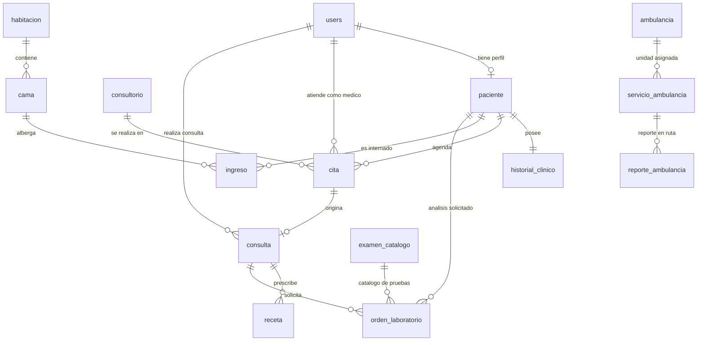

# UNIVERSIDAD CATÓLICA DE EL SALVADOR
## FACULTAD DE INGENIERÍA Y ARQUITECTURA
### INGENIERÍA EN DESARROLLO DE SOFTWARE
**Desarrollo de Aplicaciones Móviles Avanzadas — Sección “A” (Ciclo II-2026)**

---

# DOCUMENTO TÉCNICO DE ENTREGA DE AVANCE
### Hito 50% de la Nota — 31 de Octubre de 2026
**Sistema Integral Hospitalario CMO / Universitario**

### Integrantes y Responsables:
* **GUEVARA MARTINEZ, DENNIS ADEMIR** — `2023-GM-607`
* **VILLEDA ALABI, MARIO EDGARDO** — `2023-VA-651`
* **BALCACERES SILVESTRE, LUIS FELIPE** — `2023-BS-602`
* **CHAVEZ SOLITO, RENE DAVID** — `2023-CS-601`
* **CRUZ ALGARIN, KATHERINNE JEANNETTE** — `2023-CA-601`

**Santa Ana, El Salvador, 31 de octubre de 2026**

---

## 1. Resumen Ejecutivo y Cumplimiento de la Rúbrica de Evaluación (50%)

El presente documento formaliza la Entrega de Avance correspondiente al 50% de la evaluación de la cátedra de **Desarrollo de Aplicaciones Móviles Avanzadas**. El proyecto consiste en el desarrollo de un ecosistema hospitalario multiplataforma compuesto por una API REST centralizada, un panel web administrativo y aplicaciones móviles nativas para Android (Kotlin/Jetpack Compose) e iOS (Swift/SwiftUI).

A la fecha de corte del 31 de octubre de 2026, el equipo ha alcanzado los cuatro criterios de la rúbrica oficial de evaluación del 50%:

### Matriz de Cumplimiento de la Rúbrica Oficial (50% de la Nota)
| Criterio Oficial de Evaluación | Alcance y Evidencia Demostrada | Estado de Evaluación |
| :--- | :--- | :--- |
| **1. Diseño UI/UX en Figma (100%)** | Diseño interactivo completo al 100% que abarca todos los módulos del sistema: Autenticación, Consulta Médica, Pacientes, Laboratorio LIS, Hospitalización y Ambulancia. | **CUMPLIDO AL 100%** |
| **2. Arquitectura de BD y Backend** | Diagrama Entidad-Relación (DER) oficial con 15 entidades operativas, catálogo de endpoints REST documentado y seeders de prueba verificados. | **CUMPLIDO AL 100%** |
| **3. Avance Funcional (Mínimo 50%)** | Autenticación por roles (RBAC) con código de activación, CRUDs funcionales de pacientes y personal de salud, panel web con dashboard métrico y vistas operativas. | **CUMPLIDO AL 100%** |
| **4. Documentación Técnica y RBAC** | Especificación de arquitectura monorepo, diccionario de datos del DER, matriz de permisos RBAC y política de privacidad de datos de salud. | **CUMPLIDO AL 100%** |

### Enlaces Oficiales del Proyecto
* **Repositorio Monorepo GitHub:** [https://github.com/MarioAlabi/cmo-api](https://github.com/MarioAlabi/cmo-api)
* **Prototipo Oficial Interactivo en Figma:** [https://www.figma.com/design/l0n7s7zC0F6yQ1fJkP7HkL/Hospital-CMO](https://www.figma.com/design/l0n7s7zC0F6yQ1fJkP7HkL/Hospital-CMO)

---

## 2. Arquitectura del Monorepo y Paridad Multiplataforma

El repositorio institucional centraliza todas las capas de software del proyecto:

| Módulo / Directorio | Stack Tecnológico | Rol en el Ecosistema |
| :--- | :--- | :--- |
| `/backend` (o `/api`) | Laravel 11, PHP 8.4, MariaDB 10.11 | API RESTful centralizada, autenticación con Laravel Sanctum, validaciones formales, migraciones y seeders relacionales. |
| `/web` | React 19, TypeScript, Vite, Tailwind CSS | Panel administrativo y clínico para personal hospitalario: Dashboard en tiempo real, gestión de camas, ambulancia, usuarios y pacientes. |
| `/android` | Kotlin 2.0, Jetpack Compose, Material 3 | Aplicación móvil nativa para Android, orientada a médicos, personal de apoyo y pacientes. Navegación declarativa y arquitectura MVVM. |
| `/ios` | Swift 5.10, SwiftUI, Combine, SF Symbols | Aplicación móvil nativa para iOS con paridad exacta de vistas y tokens de diseño respecto a la versión de Android. |

**Principio de Paridad de Diseño:** Ambas aplicaciones móviles (iOS y Android) comparten exactamente la misma arquitectura de información, los mismos tokens de diseño (paleta médica institucional basada en verde esmeralda profundo `#0B5D4B` y acentos `#0D7A63`), y la misma estructura de llamadas al backend, adaptando los componentes nativos a las directrices de Human Interface Guidelines (Apple) y Material Design 3 (Google).

---

## 3. Core de Autenticación, Seguridad y Registro Clínico

El sistema implementa una infraestructura de seguridad robusta fundamentada en tokens de acceso personal gestionados mediante Laravel Sanctum, con expiración programada y validación en tiempo real del estado de actividad del usuario.

### Flujo de Registro Seguro con Código de Activación (6 Dígitos)
1. **Registro Administrativo Presencial:** El personal de recepción o enfermería registra al paciente en el sistema institucional mediante el CRUD administrativo web (`/pacientes`), capturando sus datos generales, DUI y contacto.
2. **Generación del Código de Activación:** Al dar de alta al paciente, el sistema genera automáticamente un código OTP de 6 dígitos con vigencia estricta de 24 horas (`POST /api/v1/pacientes/{id}/codigo-activacion`).
3. **Vinculación Móvil:** El paciente descarga la aplicación nativa en su teléfono (Android o iOS), ingresa a la pantalla de Registro, introduce su número de DUI, su código de activación de 6 dígitos y define su contraseña personal.
4. **Activación de Cuenta:** El backend valida que el código no haya expirado y vincula la cuenta de usuario (`users`) directamente al registro médico existente (`paciente`), habilitando el acceso a su expediente clínico digital.

---

## 4. Arquitectura de Base de Datos y Modelo Entidad-Relación (DER)

La base de datos relacional se compone de **15 entidades principales** organizadas en 5 subsistemas funcionales, modeladas en `DERhospital.drawio`:

### Estructura y Llaves de las 15 Tablas (DERhospital.drawio)
| Tabla | Atributos, Tipos de Datos y Restricciones (PK / FK / UK) |
| :--- | :--- |
| `users` | id (uuid, PK), nombre_completo (varchar), usuario (varchar, UK), email (varchar, UK), password (varchar), rol (enum), cargo (varchar), telefono (varchar), estado (enum) |
| `paciente` | id_paciente (uuid, PK), id_usuario (uuid, FK UK), numero_expediente (varchar, UK), nombre_completo (varchar), fecha_nacimiento (date), dui (varchar, UK), sexo (enum), telefono (varchar), direccion (text), tipo_sangre (varchar), alergias (text), id_registrado_por (uuid, FK) |
| `historial_clinico` | id_historial (uuid, PK), id_paciente (uuid, FK UK), antecedentes_personales (text), antecedentes_familiares (text) |
| `consultorio` | id_consultorio (uuid, PK), codigo (varchar, UK), planta (tinyint), nombre (varchar), activo (boolean) |
| `cita` | id_cita (uuid, PK), id_paciente (uuid, FK), id_medico (uuid, FK), id_consultorio (uuid, FK), fecha (date), hora_inicio (time), hora_fin (time), motivo (text), estado (enum), motivo_cancelacion (text), hora_llegada (datetime), id_creado_por (uuid, FK) |
| `consulta` | id_consulta (uuid, PK), id_cita (uuid, FK UK), id_medico (uuid, FK), fecha_hora_inicio (datetime), fecha_hora_fin (datetime), motivo (text), diagnostico (text), notas (text) |
| `receta` | id_receta (uuid, PK), id_consulta (uuid, FK), medicamento (varchar), dosis (varchar), frecuencia (varchar), duracion (varchar), indicaciones (text) |
| `examen_catalogo` | id_examen (uuid, PK), nombre (varchar, UK), descripcion (text), activo (boolean) |
| `orden_laboratorio` | id_orden (uuid, PK), id_consulta (uuid, FK), id_paciente (uuid, FK), id_examen (uuid, FK), id_medico (uuid, FK), estado (enum), observaciones (text), motivo_cancelacion (text), id_registrado_por (uuid, FK), fecha_solicitud (datetime), fecha_resultado (datetime) |
| `habitacion` | id_habitacion (uuid, PK), codigo (varchar, UK), planta (tinyint), tipo (enum), capacidad (tinyint) |
| `cama` | id_cama (uuid, PK), id_habitacion (uuid, FK), codigo (varchar, UK), estado (enum) |
| `ingreso` | id_ingreso (uuid, PK), id_paciente (uuid, FK), id_cama (uuid, FK), id_medico (uuid, FK), fecha_ingreso (datetime), fecha_alta (datetime), motivo (text), id_registrado_por (uuid, FK), cama_activa (uuid, UK), paciente_activo (uuid, UK) |
| `ambulancia` | id_ambulancia (uuid, PK), placa (varchar, UK), estado (enum) |
| `servicio_ambulancia` | id_servicio (uuid, PK), id_ambulancia (uuid, FK), id_solicitante (uuid, FK), id_paciente (uuid, FK), paciente_nombre (varchar), direccion (text), prioridad (enum), estado (enum), hora_solicitud (datetime), hora_cierre (datetime) |
| `reporte_ambulancia` | id_reporte (uuid, PK), id_servicio (uuid, FK), id_autor (uuid, FK), estado_paciente (enum), observaciones (text), llegada_estimada (datetime), fecha (datetime) |

### Catálogo de Endpoints de la API REST
| Método | Endpoint URI | Acceso / Rol | Descripción Funcional |
| :--- | :--- | :--- | :--- |
| `GET` | `/api/v1/publico/ocupacion` | Público | Retorna porcentaje de ocupación hospitalaria y semáforo de camas. |
| `POST` | `/api/v1/auth/login` | Público | Autenticación por usuario/password. Retorna Bearer token de Sanctum. |
| `POST` | `/api/v1/auth/registro` | Público | Auto-registro del paciente utilizando su código de activación y DUI. |
| `GET` | `/api/v1/auth/me` | Autenticado | Información del usuario en sesión, rol y datos de paciente si aplica. |
| `POST` | `/api/v1/auth/logout` | Autenticado | Revocación inmediata del token de sesión. |
| `GET` | `/api/v1/usuarios` | ADMINISTRADOR | Listado paginado de personal de salud y usuarios con filtros de rol. |
| `POST` | `/api/v1/usuarios` | ADMINISTRADOR | Registro de médicos, recepcionistas, enfermeros y administradores. |
| `PATCH` | `/api/v1/usuarios/{id}/estado` | ADMINISTRADOR | Alterna estado del usuario entre ACTIVO e INACTIVO. |
| `GET` | `/api/v1/pacientes` | ADMIN, MEDICO, RECP | Búsqueda y listado paginado de expedientes clínicos. |
| `POST` | `/api/v1/pacientes` | ADMIN, RECEPCIONISTA | Alta de nuevo paciente y generación de número de expediente único. |
| `POST` | `/api/v1/pacientes/{id}/codigo-activacion` | ADMIN, RECEPCIONISTA | Generación de código de activación de 6 dígitos con vigencia de 24h. |
| `GET` | `/api/v1/pacientes/{id}/expediente` | ADMIN, MEDICO, RECP | Consulta del expediente integral (consultas, recetas y laboratorio). |
| `GET` | `/api/v1/citas` | ADMIN, MEDICO, RECP | Gestión de citas hospitalarias con filtrado por fecha y médico. |
| `POST` | `/api/v1/citas` | MEDICO, RECEPCIONISTA | Agendamiento formal de cita en consultorio y bloque horario. |
| `POST` | `/api/v1/citas/{id}/consulta` | MEDICO | Apertura de consulta médica asociada a la cita del paciente. |
| `POST` | `/api/v1/consultas/{id}/recetas` | MEDICO | Emisión de prescripciones farmacológicas en la consulta. |
| `POST` | `/api/v1/consultas/{id}/ordenes-laboratorio` | MEDICO | Generación de órdenes de análisis de laboratorio clínico. |
| `PATCH` | `/api/v1/ordenes-laboratorio/{id}/iniciar` | ADMIN, RECEPCIONISTA | Cambio de estado de orden de laboratorio a EN_PROCESO. |
| `PATCH` | `/api/v1/ordenes-laboratorio/{id}/completar` | ADMIN, RECEPCIONISTA | Carga de resultados diagnósticos y estado COMPLETADO. |
| `GET` | `/api/v1/habitaciones` | ADMIN, MEDICO, RECP | Visualización de habitaciones y estado de las 17 camas fijas. |
| `POST` | `/api/v1/ingresos` | ADMIN, RECEPCIONISTA | Ingreso hospitalario y asignación de cama a un paciente. |
| `PATCH` | `/api/v1/ingresos/{id}/alta` | ADMIN, RECEPCIONISTA | Alta hospitalaria y liberación de cama a estado desinfección. |
| `GET` | `/api/v1/ambulancia` | ADMIN, MEDICO, RECP | Consulta de disponibilidad operativa de la ambulancia. |
| `POST` | `/api/v1/ambulancia/servicios` | ADMIN, MEDICO, RECP | Despacho de emergencia y asignación de servicio en ruta. |
| `POST` | `/api/v1/ambulancia/servicios/{id}/reportes` | ADMIN, MEDICO, RECP | Envío de signos vitales del paciente previos a la llegada. |

---

## 5. Panel Administrativo Web y CRUDs Operativos (Evidencia Real)

A continuación se presentan las capturas de pantalla tomadas del entorno web en ejecución:

### Figura 1: Pantalla de Acceso y Login (`/login`)

### Figura 2: Panel de Control Principal (`/dashboard`)

### Figura 3: CRUD de Personal de Salud y Usuarios (`/usuarios`)

### Figura 4: CRUD de Expedientes de Pacientes (`/pacientes`)

### Figura 5: Módulo de Hospitalización y Camas (`/camas`)

### Figura 6: Módulo Operativo de Ambulancia (`/ambulancia`)

---

## 6. Módulos Clínicos y de Operación Móvil (Android & iOS)

### 6.1 Autenticación y Registro de Pacientes en Móvil
> **[ESPACIO PARA CAPTURA: Autenticación y Registro Móvil (Android / iOS)]**
> *(Pegar aquí la captura de pantalla de la app móvil mostrando el inicio de sesión y el formulario de auto-registro con código de activación de 6 dígitos).*

### 6.2 Consulta Médica y Toma de Signos Vitales (Bloques de 30 Minutos)
> **[ESPACIO PARA CAPTURA: Consulta Médica y Signos Vitales (Android / iOS)]**
> *(Pegar aquí la captura de pantalla de la app móvil mostrando la vista del médico en consulta, captura de signos vitales y redacción de diagnóstico).*

### 6.3 Receta Médica Digital
> **[ESPACIO PARA CAPTURA: Receta Médica Digital (Android / iOS)]**
> *(Pegar aquí la captura de pantalla de la app móvil mostrando la receta médica emitida y su visualización en el perfil del paciente).*

### 6.4 Laboratorio Clínico LIS
> **[ESPACIO PARA CAPTURA: Laboratorio Clínico LIS (Android / iOS)]**
> *(Pegar aquí la captura de pantalla de la app móvil mostrando el listado de órdenes de laboratorio y el detalle de pruebas clínicas).*

### 6.5 Camas Hospitalarias y Servicio de Ambulancia
> **[ESPACIO PARA CAPTURA: Camas y Despacho de Ambulancia (Android / iOS)]**
> *(Pegar aquí la captura de pantalla de la app móvil mostrando el estado de camas o la vista de monitoreo de ambulancia en ruta).*

---

## 7. Matriz de Control de Acceso (RBAC) y Política de Privacidad de Datos

### 7.1 Matriz de Permisos por Rol Institucional
| Módulo / Recurso | ADMINISTRADOR | MEDICO | RECEPCIÓN / ENFERM. | PACIENTE | PARAMÉDICO |
| :--- | :--- | :--- | :--- | :--- | :--- |
| **Gestión de Usuarios y Personal** | CRUD Total | Sin Acceso | Sin Acceso | Sin Acceso | Sin Acceso |
| **CRUD Pacientes y Expedientes** | Lectura / Creación | Lectura Integral | Lectura / Registro | Lectura (Propio) | Sin Acceso |
| **Agendamiento de Citas** | Gestión Completa | Ver / Atender | Crear / Confirmar | Solicitar Cita | Sin Acceso |
| **Consulta Médica y Recetas** | Supervisión | Crear / Firmar | Sin Acceso | Ver Recetas Propias | Sin Acceso |
| **Laboratorio LIS** | Supervisión | Crear Órdenes | Actualizar Estados | Ver Resultados | Sin Acceso |
| **Camas y Hospitalización** | Gestión Completa | Lectura / Asignar | Ingresos y Altas | Sin Acceso | Sin Acceso |
| **Ambulancia y Emergencias** | Control Operativo | Reporte Médico | Despacho y Bitácora | Sin Acceso | Reporte en Ruta |

### 7.2 Política de Privacidad y Clasificación de Datos de Salud
* **Dominio Público (Acceso Libre):** Directorio de médicos de turno, avisos informativos institucionales, horario de atención y porcentaje global de ocupación de camas (semáforo público sin datos nominativos de pacientes ni diagnósticos).
* **Dominio Privado y Sensible (Acceso Restringido por Token y Rol):** Expedientes clínicos, diagnósticos CIE-10, antecedentes patológicos, recetas farmacológicas, resultados de laboratorio y bitácora clínica prehospitalaria.

---

## 8. Conclusiones del Avance 50% y Planificación Hacia la Defensa Final (Semana 6)

### 8.1 Balance General del Estado del Ecosistema al Corte del 50%
La ejecución técnica alcanzada al 31 de octubre de 2026 consolida de forma exitosa y rigurosa los requerimientos correspondientes al hito del 50% de evaluación en la cátedra de Desarrollo de Aplicaciones Móviles Avanzadas. El proyecto ha superado la etapa meramente conceptual o de prototipado estático para consolidar un núcleo de ingeniería sólido: un backend operativo sobre Laravel 11 y MariaDB con 15 entidades relacionales formalizadas en el DER, un esquema de seguridad basado en tokens Sanctum con código de activación temporal, y los cimientos estructurales de las aplicaciones web y móviles nativas (Android e iOS).

No obstante, como equipo mantenemos una postura de autoevaluación crítica y transparente: este avance no representa un sistema finalizado, sino una plataforma estable sobre la cual se construirán y conectarán las interacciones clínicas complejas durante la segunda mitad del ciclo.

### 8.2 Diagnóstico Real del Panel Web Administrativo (Integración API vs. Maquetación con Mock Data)
Para fines de claridad y honestidad académica en la evaluación, es fundamental diferenciar los módulos web que ya operan conectados a la base de datos de aquellos que actualmente se encuentran en fase de validación de interfaz mediante datos simulados:

1. **Módulos con Integración Total a la API REST (Backend Real):**
   * **Autenticación y Sesión (`/login`, `/dashboard`):** Validación de credenciales contra base de datos, persistencia de tokens Sanctum y control de acceso para el rol `ADMINISTRADOR`.
   * **Gestión de Personal y Usuarios (`/usuarios`):** CRUD funcional que permite el alta, listado paginado, búsqueda y alternancia de estado (Activo/Inactivo) de personal médico, recepcionistas y administradores consumiendo directamente los endpoints `/api/v1/usuarios`.
   * **Gestión de Pacientes y Expedientes (`/pacientes`):** Registro formal de pacientes, validación de unicidad de DUI, asignación automática de número de expediente y generación del código de activación OTP de 6 dígitos mediante llamadas activas a `/api/v1/pacientes`.

2. **Módulos con Interfaz Interactiva en Mock Data (Pendientes de Enlace a la API):**
   * **Hospitalización y Camas (`/camas`), Ambulancia (`/ambulancia`), Citas (`/citas`), Laboratorio (`/laboratorio`), Turnos e Inventario:** Estos módulos cuentan con un diseño visual completo, componentes reactivos, modales y flujos de usuario totalmente terminados en React y Tailwind CSS, pero actualmente operan con estructuras de datos locales en memoria (`mock data`). Esta decisión técnica permitió al equipo prototipar y verificar la experiencia de usuario (UX) y las interacciones visuales complejas antes de enlazar los endpoints de la API, labor que constituye el núcleo del trabajo web para el 100%.

### 8.3 Diagnóstico y Alcance Actual de las Aplicaciones Móviles (Android & iOS)
En el ámbito móvil —eje central de la cátedra— se ha priorizado el desarrollo nativo respetando las guías de diseño de cada plataforma (Material 3 en Android y Human Interface Guidelines en iOS), delimitando los roles de acceso según la política de operación hospitalaria:

* **Aplicación Android (Kotlin, MVVM, Retrofit / XML & Compose):**
  * *Avance consolidado:* Implementación del contenedor de dependencias (`AppContainer`), repositorio de red con interceptores de autenticación Bearer, persistencia de sesión en DataStore y política de acceso por rol (`RoleAccessPolicy` para `MEDICO` y `RECEPCIONISTA`). Se integraron las vistas de inicio del médico, agenda de citas, consulta médica activa con cronómetro de 30 minutos, consulta de expedientes clínicos y visualización básica de órdenes de laboratorio conectadas a la API.
  * *Trabajo pendiente reconocido:* Resta profundizar en la integración completa de los flujos de recepción (admisión formal y triaje enlazado directamente a los endpoints de camas e ingresos), perfeccionar la política de caché local para tolerancia a fallos de red y culminar la sincronización en vivo.
* **Aplicación iOS (Swift, SwiftUI, MVVM, URLSession & Keychain):**
  * *Avance consolidado:* Arquitectura modular con `SessionStore`, almacenamiento seguro en Keychain, flujo de inicio de sesión por rol y auto-registro de pacientes validando el DUI y código de activación de 6 dígitos contra el backend. Se dispone de la estructura de vistas para `PACIENTE` (inicio, citas, historial de expediente y exámenes) y `MEDICO` (agenda semanal, detalle de consulta con borradores clínicos y visualización de camas).
  * *Trabajo pendiente reconocido:* Falta completar la conexión de acciones transaccionales avanzadas (envío definitivo de recetas compuestas y órdenes múltiples hacia la base de datos central), la implementación del canal de WebSockets para telemetría de ambulancia y la realización de pruebas exhaustivas en dispositivos físicos con diversas resoluciones.

### 8.4 Plan de Trabajo Prioritario Hacia la Entrega Final al 100% (Semana 6)
Conscientes de las brechas técnicas actuales, el equipo ha trazado una hoja de ruta concreta y calendarizada para culminar el proyecto con éxito:

1. **Sustitución de Mock Data en Web:** Conectar las interfaces ya desarrolladas de Camas, Ambulancia, Laboratorio y Citas a los controladores correspondientes de Laravel.
2. **Sincronización en Tiempo Real (Laravel Reverb / WebSockets):** Implementar la escucha de eventos en tiempo real para el rastreo y despacho de ambulancias y la actualización de estados de laboratorio tanto en web como en las apps móviles.
3. **Consolidación de Flujos Clínicos E2E (Móvil-Backend-Web):** Probar el circuito integral del paciente: registro en recepción (Web) -> activación de cuenta (Móvil) -> agendamiento de cita -> atención médica (Android/iOS) -> emisión de recetas y órdenes -> visualización de resultados en tiempo real.
4. **Optimización, Seguridad y Empaquetado Release:** Manejo unificado de excepciones de red, validación rigurosa de políticas de privacidad para datos médicos sensibles, generación de APK/AAB firmados en Android y preparación del empaquetado final para la defensa ante el comité evaluador.
